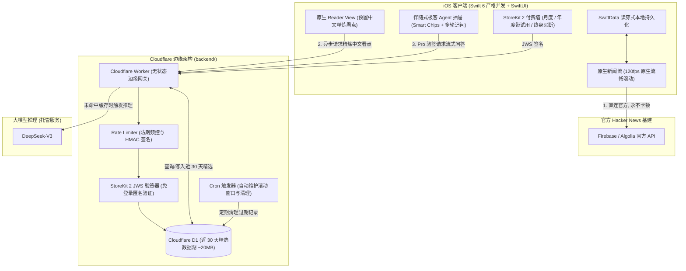
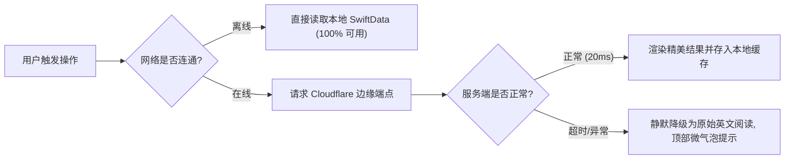

# HNEveryDay Pro 付费墙与后端托管架构最终实施规范 (RFC)

> **版本**：v1.0.0 (Production Ready)  
> **更新时间**：2026-10-24  
> **核心定位**：极客原生体验第一、零配置即开即用、中心化降本提速、无侵入式高价值变现

---

## 目录
1. [设计哲学与关键专业取舍](#一-设计哲学与关键专业取舍)
2. [总体系统架构 (双轨解耦模式)](#二-总体系统架构-双轨解耦模式)
3. [商业化与功能权益矩阵 (Freemium)](#三-商业化与功能权益矩阵-freemium)
4. [StoreKit 2 付费墙体验与审核合规设计](#四-storekit-2-付费墙体验与审核合规设计)
5. [伴随式极客 Agent 交互规范 (Action-First)](#五-伴随式极客-agent-交互规范-action-first)
6. [Cloudflare 边缘中台与 D1 精炼数据湖规格](#六-cloudflare-边缘中台与-d1-精炼数据湖规格)
7. [客户端重构与冗余清理计划](#七-客户端重构与冗余清理计划)
8. [离线容灾与优雅降级策略](#八-离线容灾与优雅降级策略)
9. [分阶段交付路线图与验收检查单](#九-分阶段交付路线图与验收检查单)

---

## 一、 设计哲学与关键专业取舍

经过多次批判性推演，本方案确立了以下不可妥协的设计原则：

1. **绝对不搞单点劫持 (No Single Point of Failure)**：
   * **决策**：新闻列表与原始讨论区 **100% 保持直连 Hacker News 原生官方 API**。
   * **理由**：极客用户对“刷不出新闻”零容忍。即使自建的 Cloudflare 后端或大模型遭遇网络抖动，应用依然是世上最流畅、抗灾能力最强的 120fps 原生客户端，绝不白屏。
2. **中心化缓存打底，Token 边际成本趋零 (Cache-First LLM)**：
   * **决策**：全网公共热帖由边缘服务器进行“惰性生成 + 永久缓存”。
   * **理由**：HN 头条文章高度重合，首位读者触发后写入 Cloudflare D1，后续上万读者直接 20ms 秒开，API 成本暴降 95% 以上，支撑“基础 AI 永久免费”的底气。
3. **彻底卸下用户配置包袱 (Zero Config / Deprecate BYOK)**：
   * **决策**：完全移除客户端 API Key、Base URL 输入框与钥匙串存储。
   * **理由**：消除用户注册、获取、复制黏贴 Key 的心智摩擦，提供像 Apple 原生备忘录一样即开即用的丝滑感。
4. **单手轻操作驱动的 Agent (Action-First Companion)**：
   * **决策**：拒绝小屏幕上空荡荡的聊天输入框，主打动态提炼的“智能快捷胶囊（Smart Chips）”，单手点一下即出答案，兼顾深度追问。
5. **克制温和的变现触达 (Gentle Paywall)**：
   * **决策**：严禁 App 启动强弹窗。仅在用户主动探索 Pro 高级特权时，通过半屏原生 Sheet 优雅展示。

---

## 二、 总体系统架构 (双轨解耦模式)



---

## 三、 商业化与功能权益矩阵 (Freemium)

| 功能特权 | 免费用户 (Free Tier) | Pro 会员 (Pro Tier) | 设计目的与用户心理 |
| :--- | :--- | :--- | :--- |
| **基础体验** | 120fps 极速滑动、无广告、离线缓存 | 120fps 极速滑动、无广告、离线缓存 | 保证基础体验口碑，杜绝一星差评 |
| **标题多语言翻译** | **永久免费** (全量边缘缓存秒开) | **永久免费** (同享 20ms 秒开) | 极度友好的入门门槛，吸引非英语母语极客 |
| **单篇快速 AI 摘要** | **永久免费** (预置精炼两段式中文看点) | **永久免费** (同享秒开) | 培养对 AI 总结的强依赖性 |
| **伴随式极客 Agent** | 展示入口与精美试看 Demo (点击弹付费墙) | **无限次交互** (多轮对话、代码拆解、争议对比) | **主打付费转化引擎**，深度解决“读懂硬核文章”的痛点 |
| **近 30 天技术趋势搜索** | 仅支持当前 Feed 列表本地过滤 | **跨 30 天全量精华库高速检索与趋势提炼** | 针对架构师和创业者的专业技术情报利器 |
| **知识沉淀与导出** | 基础 Markdown 复制分享 | **结构化深度研报、第二大脑模板** | 满足重度生产力用户需求 |
| **极客个性化** | 系统默认极客主题 | **专属 Pro App 图标、复古终端与极简主题** | 极客身份认同感与社交炫耀属性 |

---

## 四、 StoreKit 2 付费墙体验与审核合规设计

### 1. 定价矩阵
* **月度订阅 (`com.hneveryday.pro.monthly`)**：`$2.99 / 月`（低门槛体验）。
* **年度订阅 (`com.hneveryday.pro.annual`)**：`$19.99 / 年`（**主推项**，赠送 **7 天免费试用**，折合每月约 $1.66）。
* **终身买断 (`com.hneveryday.pro.lifetime`)**：`$49.99`（一次性付费，满足排斥订阅制的硬核用户）。

### 2. 付费墙触发与呈现策略 (Non-Intrusive)
* **禁止行为**：启动冷启动强弹、首次阅读强弹。
* **合法触发场景**：
  1. 用户在文章阅读页/讨论区点击 **✨ Ask Agent**；
  2. 用户在搜索栏点击 **“近 30 天深度情报检索”** 标签；
  3. 用户在设置页主动点击 **“升级到 HNEveryDay Pro”**。
* **视觉质感**：基于 `AppTheme` 打造，使用 `.ultraThinMaterial` 毛玻璃背景、柔和光晕、清晰的 Free vs Pro 对比卡片。

### 3. App Store 审核合规必查清单 (Review Checklist)
* [ ] 提供显眼的 **“恢复购买 (Restore Purchases)”** 按钮，点击必须有即时 HUD 反馈。
* [ ] 必须包含清晰的 **隐私政策 (Privacy Policy)** 与 **使用条款 (EULA / Terms of Use)** 链接。
* [ ] 清晰标注自动续订规则（将在周期结束前 24 小时扣费，可随时在 Apple ID 设置中取消）。
* [ ] 包含符合苹果 AI 审核规范的免责声明（*“AI 观点基于文章与社区讨论提炼，仅供技术参考”*）与轻触长按复制/分享/反馈机制。

---

## 五、 伴随式极客 Agent 交互规范 (Action-First)

### 1. 唤起与交互形式
* 在阅读器页面与评论区右下角常驻悬浮微质感胶囊按钮 `✨ Ask Agent`。
* 点击呼出原生 `.sheet(isPresented:)`，默认高度占用屏幕 60%（可拖拽至全屏）。

### 2. 界面布局与动态智能胶囊
```
+------------------------------------------------+
|  [--- 拖拽条 ---]                                |
|  ✨ HNEveryDay Geek Agent                  [ X ] |
+------------------------------------------------+
| 💡 智能快捷分析 (单手轻点即得答案):             |
|  [🔥 评论区最大争议是什么？]                     |
|  [💻 提取并解释核心代码/架构设计]                |
|  [🆚 文中提到的竞品或替代方案对比]               |
|  [🎯 这项技术的适用与不适用场景]                 |
+------------------------------------------------+
| 💬 自由深度追问:                                |
|  User: ...                                     |
|  Agent: (流式打字机逐字输出, 支持代码块与语法高亮)|
|                                                |
+------------------------------------------------+
| [ 输入技术追问细节...                 ] [ 发送 ] |
+------------------------------------------------+
```

### 3. 触感与动画 (Apple Design)
* 呼出抽屉时触发轻微触感：`UIImpactFeedbackGenerator(style: .light).impactOccurred()`。
* 流式文字输出采用平滑动画，配合 `ScrollViewReader` 自动平滑吸附底部。
* 提供显眼的 **停止生成 (Stop)** 按钮，允许用户随时打断。

---

## 六、 Cloudflare 边缘中台与 D1 精炼数据湖规格

### 1. 代码工程组织
* 在主工程根目录下建立 `backend/` 目录：
  ```
  HNEveryDay/
  ├── HNEveryDay/             # iOS 原生客户端
  ├── backend/                # Cloudflare 边缘服务
  │   ├── wrangler.toml       # Cloudflare 配置文件
  │   ├── package.json
  │   ├── tsconfig.json
  │   ├── schema.sql          # D1 数据库初始化 SQL
  │   └── src/
  │       ├── index.ts        # 路由入口
  │       ├── db.ts           # D1 访问封装
  │       ├── ai.ts           # DeepSeek-V3 对接
  │       ├── auth.ts         # StoreKit 2 JWS 验签与 HMAC 防刷
  │       └── cron.ts         # 定时滚动淘汰任务
  ```

### 2. D1 数据库建模 (`schema.sql`)
```sql
-- 近 30 天精选文章表 (Score >= 5 或 Descendants >= 2)
CREATE TABLE IF NOT EXISTS stories (
    id INTEGER PRIMARY KEY,
    title TEXT NOT NULL,
    translated_title TEXT,
    url TEXT,
    by TEXT,
    score INTEGER,
    time INTEGER NOT NULL,
    descendants INTEGER DEFAULT 0,
    summary_cn TEXT,
    key_points TEXT,  -- JSON 数组: 核心看点
    created_at TIMESTAMP DEFAULT CURRENT_TIMESTAMP
);

CREATE INDEX IF NOT EXISTS idx_stories_time ON stories(time DESC);
CREATE INDEX IF NOT EXISTS idx_stories_score ON stories(score DESC);

-- 自动滚动清理视图/策略：
-- 由 Cron 定时执行: DELETE FROM stories WHERE time < strftime('%s', 'now', '-30 days');
```

### 3. API 接口定义
* `POST /api/v1/translate-batch`: 批量翻译标题（优先查 D1 缓存，未命中则并发调 DeepSeek 并写入缓存）。
* `POST /api/v1/summary`: 获取或生成文章深度摘要（惰性缓存模式，全网只跑一次）。
* `POST /api/v1/agent/chat`: 流式 SSE 对话接口（**需校验 StoreKit 2 JWS 凭证**）。
* `GET /api/v1/trends`: 查询近 30 天高赞技术趋势榜单与关键词检索。

### 4. 成本与防刷安全防护
* **HMAC 请求头校验**：客户端带上基于 App 内置盐 + 时间戳生成的签名，过滤非官方脚本。
* **速率限制 (Rate Limiting)**：免费接口限制单 IP 每分钟最多 60 次请求。
* **Apple JWS 验签**：对 `/agent/chat` 接口，Worker 利用 Web Crypto API 校验由 Apple 官方签名的 Transaction JWS，免去传统账号密码体系，100% 保护隐私。

---

## 七、 客户端重构与冗余清理计划

### 1. 彻底移除旧版 BYOK 相关代码
* 彻底清理 `SettingsView.swift` 中的以下元素：
  * ❌ 移除 `aiProvider` 选择器
  * ❌ 移除 `ai_api_key` SecureField 输入框
  * ❌ 移除 `ai_api_url` Base URL 输入框
  * ❌ 移除 `ai_model_name` 模型输入框
  * ❌ 移除 `KeychainHelper` 中相关的 API Key 读写逻辑
* 重构后的 `SettingsView.swift`：
  * ✅ **Pro 会员状态卡片**（展示当前权益、到期时间、管理/恢复订阅）
  * ✅ **外观与阅读**（主题切换、字体与排版、双语对照模式）
  * ✅ **缓存管理**（清空离线缓存）
  * ✅ **关于与协议**（版本号、EULA 使用条款、隐私政策）

### 2. 重构 `AIService.swift`
* 将底层调用点统一封装为对接自建 Cloudflare Worker。
* 保持既有的 `TaskCoalescer`（在途请求合流屏障），在客户端形成第一道防重屏障，后端 D1 形成第二道持久缓存屏障。

---

## 八、 离线容灾与优雅降级策略



* **静默容错**：在网络故障或服务器偶尔抖动时，绝不弹出突兀的错误阻断弹窗，而是通过极简的胶囊 Toast 提示“网络波动，已为您展示原文”，保障沉浸式阅读连续性。

---

## 九、 分阶段交付路线图与验收检查单

### 阶段 1：Cloudflare 后端与 D1 数据库落地 (`backend/`)
- [ ] 创建 `backend/` 目录与 `package.json`，配置 `wrangler.toml`。
- [ ] 编写 `schema.sql`，本地及生产创建 D1 数据库表。
- [ ] 编写 `src/index.ts`，实现翻译与单篇摘要的 D1 缓存/回源流水线。
- [ ] 编写 `src/cron.ts`，实现滚动清理 30 天前过期文章。
- [ ] 部署并验证端点：`npx wrangler deploy`。

### 阶段 2：iOS 客户端全面减负与后端连通
- [ ] 清理 `SettingsView.swift` 中的所有 API Key / Provider 冗余控件。
- [ ] 更新 `AIService.swift` 指向 Cloudflare 后端，打通无配置极速翻译与摘要。
- [ ] 确保严格并发安全与 `TaskCoalescer` 在途合流工作正常。

### 阶段 3：StoreKit 2 付费墙与订阅管理集成
- [ ] 创建 `StoreManager.swift`（基于 StoreKit 2 监听 Transaction、计算 Pro 权限、缓存 JWS Token）。
- [ ] 创建原生 `PaywallView.swift`（符合 Apple HIG，包含月度、年度带试用、终身买断与恢复购买）。
- [ ] 在 `SettingsView` 与功能门禁处接入 `PaywallView`。

### 阶段 4：伴随式极客 Agent 交互与跨月情报检索
- [ ] 创建 `AgentSheetView.swift`，包含顶部 3 个智能胶囊（Smart Chips）与流式追问框。
- [ ] 客户端对接 `/api/v1/agent/chat` SSE 流式传输，实现顺滑打字机动画。
- [ ] 完善全流程测试（离线、恢复购买、流式打断、长讨论区分析）。

---

*本实施方案已归档至项目工程目录，可作为后续开发与 App Store 上架审核的技术依据。*
