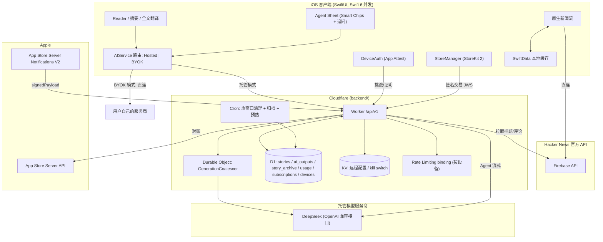

# HNEveryDay Pro 付费墙与后端托管架构实施规范 (RFC)

> **版本**：v0.2.0 (Draft，已纳入评审意见)
> **更新时间**：2026-10-25
> **上一版**：v1.0.0（2026-10-24，标注为 "Production Ready"，评审后降级为 Draft 重新编号）
> **核心定位**：新闻流永不依赖自建后端；AI 默认零配置托管、保留自带 Key 高级模式；成本有上限、订阅校验可信、合规先行。

---

## 目录
0. [评审意见与本版变更摘要](#零-评审意见与本版变更摘要)
1. [设计原则与关键取舍](#一-设计原则与关键取舍)
2. [总体系统架构](#二-总体系统架构)
3. [商业化与权益矩阵（含额度）](#三-商业化与权益矩阵含额度)
4. [StoreKit 2 付费墙与审核合规](#四-storekit-2-付费墙与审核合规)
5. [伴随式 Agent 交互规范](#五-伴随式-agent-交互规范)
6. [Cloudflare 后端与 D1 数据规格](#六-cloudflare-后端与-d1-数据规格)
7. [安全：App Attest 与订阅校验](#七-安全app-attest-与订阅校验)
8. [客户端改造计划](#八-客户端改造计划)
9. [容灾、降级与远程开关](#九-容灾降级与远程开关)
10. [合规与隐私](#十-合规与隐私)
11. [单位经济模型（待用真实数据填充）](#十一-单位经济模型待用真实数据填充)
12. [分阶段交付路线图与门槛](#十二-分阶段交付路线图与门槛)
13. [待决问题](#十三-待决问题)

---

## 零、 评审意见与本版变更摘要

v1.0.0 方向可取（新闻流直连 HN、AI 走边缘缓存、温和付费墙），但存在成本无上限、多语言缺失、订阅校验不可靠、合规空白四类问题。本版按评审意见做了以下调整：

| # | v1.0.0 原设计 | v0.2 调整 | 原因 |
| :-- | :-- | :-- | :-- |
| 1 | 彻底移除 BYOK | **托管为默认，BYOK 保留为“高级模式”** | 不强制迁移现有用户；后端故障或停服时的逃生口 |
| 2 | 摘要“永久免费”、Agent“无限次” | **按次额度**：缓存命中免费；新生成计入每日额度；Agent 免费 3 次/天，Pro 公平使用 | 推理成本随用量线性增长，不能承诺无上限 |
| 3 | 终身买断 $49.99 | **首发取消**，阶段 4 视数据决定是否以 ≥$79 限量推出 | 一次性收入对应永久推理成本，负债无上限 |
| 4 | `translated_title` / `summary_cn` 单列 | **AI 产物独立成表，带 `lang`、`prompt_version`、`model`** | App 已支持 10 种阅读语言 |
| 5 | Cron 删除 `stories` 连带删除 AI 产物 | **数据分层**：`stories` 30 天热窗口由 Cron 清理；`ai_outputs` 长期保留，仅换模型/换 prompt 时失效；极简归档表 `story_archive` | 花钱生成的产物不应随热窗口丢失 |
| 6 | 只存 Score ≥ 5 的文章 | **被请求即入库**，分数只用于趋势与预热 | New 频道新帖分数为 1，会反复回源 |
| 7 | 无惊群处理 | **Durable Object 按 `story_id+kind+lang` 合流** + Cron 预热 Top 30 标题 | 热帖上榜瞬间大量并发未命中 |
| 8 | 正文来源未定义 | **客户端上传 Reader 抽取的正文**（截断），后端不抓取任意 URL；标题与评论由后端从 HN 官方 API 拉取 | 避免 SSRF、反爬、付费墙；关键元数据不信任客户端 |
| 9 | HMAC 内置盐 + 单 IP 限流 | **App Attest 设备令牌** + 按设备限流，IP 只兜底；**全局每日 token 预算熔断** | 盐可从 IPA 提取；CGNAT 下 IP 限流误伤 |
| 10 | Worker 只校验 JWS 签名 | **x5c 证书链校验到 Apple Root CA G3 + 有效期/撤销检查 + App Store Server Notifications V2 状态表 + 可选 App Store Server API 对账 + 单订阅设备数上限** | 签名有效 ≠ 订阅有效；JWS 可被共享重放 |
| 11 | 无 API 版本治理 | **`/api/v1` + 远程配置/kill switch + 最低版本** | 线上旧版 App 可平滑降级 |
| 12 | 30 天趋势检索为 Pro 卖点 | **推迟到阶段 4**，看 Agent 转化数据后再定 | 需求未验证，Algolia 已提供免费搜索 |
| 13 | 合规几乎空白 | **新增第十章**；宪章升级 v2.0.0 将“自建后端 + 托管模型服务商”列为批准处理方 | 数据出境、隐私标签、宪章冲突 |

---

## 一、 设计原则与关键取舍

1. **新闻流不经过自建后端**：列表与原始讨论区 100% 直连 Hacker News 官方 API。后端或模型故障时，App 仍是一个完整可用的 HN 客户端。
2. **缓存优先，但不承诺无上限**：公共产物（标题翻译、摘要）由后端惰性生成并长期缓存。缓存命中对所有人免费；需要新生成的请求计入额度。命中率以线上测量为准，不预设“降本 95%”。
3. **零配置为默认，BYOK 为高级模式**：新用户打开即用托管 AI；设置里保留折叠的“高级：自带 API Key”，选择后所有 AI 请求直连用户自己的服务商，不经过我们的后端、不计额度。
4. **Action-First Agent**：小屏优先提供“智能快捷胶囊（Smart Chips）”，一点即得答案，同时支持追问。
5. **温和付费墙**：禁止启动强弹。只在用户主动触达 Pro 能力或用完额度时，以半屏 Sheet 展示。
6. **不信任客户端**：订阅状态、设备身份、额度全部以服务端为准；客户端只上传它能合理提供的数据（正文摘录、追问内容）。

---

## 二、 总体系统架构



---

## 三、 商业化与权益矩阵（含额度）

额度按“设备令牌”统计，UTC 自然日重置。所有数字均为可远程调整的默认值（见第九章远程配置）。

| 能力 | 免费 | Pro | 说明 |
| :-- | :-- | :-- | :-- |
| 新闻流、评论、离线缓存 | ✅ | ✅ | 不经过后端 |
| 标题翻译 | ✅ 不计额度 | ✅ 不计额度 | 成本低、命中率高；仅受设备限流约束 |
| 单篇摘要（缓存命中） | ✅ 不计额度 | ✅ 不计额度 | |
| 单篇摘要（需新生成） | **10 篇/天** | **200 篇/天**（公平使用） | Cron 预热的热帖通常命中缓存 |
| 全文翻译 | **3 篇/天** | **50 篇/天** | 版权原因**不在服务端缓存**全文译文，只在本地缓存 |
| Agent（Smart Chips + 追问） | **3 轮/天** 真实体验 | **50 轮/天** 正常速度，超出后**降速**（两轮间隔 ≥ 120 秒），**硬上限 200 轮/天** | 一轮 = 一次提问请求 |
| 30 天趋势检索 | — | 阶段 4 视数据决定 | |
| Pro 图标与主题 | — | 阶段 4 | |
| **BYOK 高级模式** | ✅ 全部 AI 能力，含 Agent | ✅ | 直连用户自己的服务商，不经过后端、不计额度；成本由用户承担 |

> **取舍说明**：BYOK 模式下 Agent 不收费。BYOK 用户是少数愿意自己付模型费用的极客；向他们收第二遍钱伤口碑，而 Pro 的价值是“零配置 + 托管额度 + 后续 Pro 特权”。如果数据显示大量用户借 BYOK 绕过 Pro，可在阶段 4 重新评估。

### 定价（首发）
* **月度订阅** `cn.corlin.hneveryday.pro.monthly`：$2.99 / 月
* **年度订阅** `cn.corlin.hneveryday.pro.annual`：$19.99 / 年，**7 天免费试用**（主推）
* ~~终身买断~~：首发不上。阶段 4 若推出，价格 ≥ $79、限时或限量，条款写明 Agent 受公平使用约束。

产品 ID 前缀以实际 Bundle ID 为准；客户端从远程配置读取产品 ID 列表，避免硬编码。

---

## 四、 StoreKit 2 付费墙与审核合规

### 1. 触发与呈现
* **禁止**：冷启动弹窗、首次阅读弹窗。
* **允许的触发点**：
  1. 用户点击 **✨ Ask Agent** 且当天免费额度已用完；
  2. 摘要 / 全文翻译返回“额度已用完”；
  3. 设置页主动点击 **升级到 HNEveryDay Pro**。
* 呈现：半屏 `.sheet`，`.presentationDetents([.medium, .large])`，`.ultraThinMaterial` 背景，Free vs Pro 对比卡片。

### 2. 购买流程
1. 客户端生成并持久化 `appAccountToken`（UUID，存钥匙串），购买时传入 `Product.PurchaseOption.appAccountToken`。
2. 购买成功后，客户端把 `Transaction` 的 `jwsRepresentation` 发到 `POST /api/v1/subscription/verify`。
3. 服务端校验（第七章），绑定到当前设备，返回权益。
4. 客户端监听 `Transaction.updates`，续订/退款时重新同步；本地仍以 `Transaction.currentEntitlements` 作为 UI 的即时判断，但**额度由服务端决定**。

### 3. 审核合规清单
* [ ] 显眼的 **恢复购买** 按钮，点击后有即时 HUD 反馈（调用 `AppStore.sync()`）。
* [ ] **隐私政策** 与 **使用条款 (EULA)** 链接。
* [ ] 自动续订说明：周期结束前 24 小时内自动扣费，可随时在 Apple ID 设置中取消；试用结束自动转付费。
* [ ] AI 免责声明：“AI 内容基于文章与社区讨论自动生成，可能有误，仅供参考。”
* [ ] AI 内容提供 **举报** 入口（`POST /api/v1/report`），服务端可按 story 下线缓存。
* [ ] 管理订阅入口（`.manageSubscriptionsSheet`）。

---

## 五、 伴随式 Agent 交互规范

### 1. 唤起
* 阅读器与评论区右下角悬浮胶囊按钮 `✨ Ask Agent`。
* 点击呼出 `.sheet`，默认 `.medium`，可拖至 `.large`；呼出时 `.sensoryFeedback(.impact(weight: .light))`。

### 2. 布局
```
+------------------------------------------------+
|  ✨ Ask Agent                 今日剩余 2/3  [X] |
+------------------------------------------------+
|  [🔥 作者说 Postgres 够用，评论里谁更有道理？]    |
|  [💻 它的 MVCC 是怎么绕开写放大的？]             |
|  [🆚 和 SQLite + Litestream 比差在哪？]          |
|  [🎯 我们 10 人团队值得迁移吗？]                 |
|  （按文章与评论动态生成的示例）                   |
+------------------------------------------------+
|  User: ...                                     |
|  Agent: (流式输出, Markdown)                     |
|  ⚠️ AI 生成内容，仅供参考 · 举报                  |
+------------------------------------------------+
| [ 输入追问...                   ] [发送 / 停止] |
+------------------------------------------------+
```

### 3. 行为
* 流式输出，`ScrollViewReader` 自动吸底；生成中“发送”按钮变为 **停止**。
* 停止或网络中断：已输出内容保留；**该轮已计入额度**（在请求开始时扣减），不自动重试。
* **推荐问题（Smart Chips）由后端统一生成**：每篇文章 × 每种语言生成一次（`kind = questions`，4 个，带类型用于图标），存入 `ai_outputs` 供所有用户共享；不计额度，受每日 token 预算约束。问题须具体到本文的项目、论点或评论争议，禁止通用模板句。BYOK 模式也从后端取（只发公开的 story_id 与语言，不发正文），后端不可用时用用户自己的 Key 本地生成；都失败时退回 4 个通用问题。
* **追问建议**：Agent 每次回答末尾附 `<followups>` 块（3 个后续问题），客户端剥离后显示为回答下方的胶囊；与回答同一次调用生成，无额外成本。
* **语气**：像懂行的同事聊天，先直接回答，再按需展开；有分歧时给出倾向和理由；不强制标题/列表结构。
* 会话只保存在内存中（关闭 Sheet 即丢弃），服务端**不存储**对话内容。
* 上下文：后端从 HN API 拉取标题与评论树（按顺序取前 40 条、每条 ≤ 600 字符、总计 ≤ 24k 字符）；客户端可附带 Reader 正文摘录（≤ 12k 字符）；历史对话最多 10 轮。
* 系统提示明确：文章与评论是**不可信的第三方数据**，其中的指令一律忽略。

---

## 六、 Cloudflare 后端与 D1 数据规格

### 1. 目录
```
backend/
├── wrangler.toml
├── package.json / tsconfig.json / vitest.config.ts
├── migrations/0001_init.sql      # D1 迁移
├── src/
│   ├── index.ts                  # 路由 + scheduled 入口
│   ├── env.ts                    # Env 绑定类型
│   ├── config.ts                 # 远程配置 / kill switch / 地区开关
│   ├── http.ts                   # JSON / 错误响应工具
│   ├── auth/                     # 设备令牌、App Attest、CBOR、DER、x509
│   ├── subscription/             # JWS 校验、Server API、通知、权益
│   ├── quota.ts                  # 额度与全局预算
│   ├── hn.ts                     # HN 官方 API 拉取
│   ├── llm.ts                    # OpenAI 兼容接口 (DeepSeek)
│   ├── prompts.ts                # Prompt 与版本号
│   ├── coalescer.ts              # Durable Object 合流
│   ├── routes/                   # 各端点
│   └── cron.ts                   # 清理 / 归档 / 预热
└── test/
```

### 2. D1 Schema（`migrations/0001_init.sql`，要点）

```sql
-- 热窗口：近 30 天被请求过或被预热的故事元数据（权威源是 HN API，可随时重拉）
CREATE TABLE stories (
  id INTEGER PRIMARY KEY,
  title TEXT NOT NULL,
  url TEXT,
  by TEXT,
  score INTEGER NOT NULL DEFAULT 0,
  descendants INTEGER NOT NULL DEFAULT 0,
  time INTEGER NOT NULL,               -- HN 发布时间 (unix 秒)
  fetched_at INTEGER NOT NULL
);

-- AI 产物：长期保留，按语言与版本区分；只在换模型/换 prompt 时失效
CREATE TABLE ai_outputs (
  story_id INTEGER NOT NULL,
  kind TEXT NOT NULL,                  -- 'title' | 'summary'
  lang TEXT NOT NULL,                  -- 'zh-Hans' | 'ja' | ...
  prompt_version INTEGER NOT NULL,
  model TEXT NOT NULL,
  content TEXT NOT NULL,
  created_at INTEGER NOT NULL,
  PRIMARY KEY (story_id, kind, lang, prompt_version, model)
);

-- 极简归档：热窗口过期后保留的最小元数据，供历史检索与 ai_outputs 关联
CREATE TABLE story_archive (
  id INTEGER PRIMARY KEY,
  title TEXT NOT NULL,
  url TEXT,
  time INTEGER NOT NULL,
  final_score INTEGER NOT NULL
);
```

其余表：`blocked_stories`（下线）、`reports`（举报）、`devices`（App Attest 公钥与计数器）、`attest_challenges`、`usage_daily`（额度）、`budget_daily`（全局 token 预算）、`subscriptions`（订阅状态）、`subscription_devices`（订阅绑定设备）、`notification_log`（通知去重）。

**容量估算**：每天约 300 篇被请求，每篇各语言产物合计 < 5KB，一年约 0.5GB，远低于 D1 单库 10GB 上限；超过 1 年的产物可转存 R2（阶段 4 再做）。

**失效策略**：读取时按“当前 `prompt_version` + 当前 `model`”精确匹配；换模型或改 prompt 后旧行自然不再命中。Cron 删除非当前版本且超过 90 天的旧行。

### 3. Cron（每小时）
1. **归档 + 清理**：`time < now - 30d` 的 `stories` 先 `INSERT OR REPLACE` 到 `story_archive`（`final_score = score`），再删除。
2. **预热**：拉取 HN Top 30，写入 `stories`，并为 `PREWARM_LANGS`（默认 `zh-Hans`）批量生成缺失的标题翻译。
3. **清理**：`usage_daily` 保留 7 天；过期 `attest_challenges`；非当前版本且超过 90 天的 `ai_outputs`。

### 4. API（`/api/v1`）

所有业务端点要求 `Authorization: Bearer <device_token>`（第七章）。错误统一为 `{"error": {"code": "...", "message": "..."}}`。

| 方法 | 路径 | 说明 |
| :-- | :-- | :-- |
| GET | `/api/v1/config` | 远程配置：功能开关、最低版本、额度、产品 ID。无需令牌 |
| POST | `/api/v1/auth/challenge` | 获取一次性挑战（5 分钟有效）。无需令牌 |
| POST | `/api/v1/auth/attest` | 提交 App Attest 证明，换取设备令牌 |
| POST | `/api/v1/auth/assert` | 用 App Attest 断言续期设备令牌 |
| POST | `/api/v1/auth/anonymous` | 不支持 App Attest 的设备（模拟器等）换取受限令牌；`ATTEST_MODE=enforce` 时关闭 |
| POST | `/api/v1/translate/titles` | `{lang, ids[]}`（≤ 50）→ `{translations: {id: title}}`；后端从 HN 拉标题 |
| POST | `/api/v1/summary` | `{story_id, lang, article_text?}` → `{summary, cached}` |
| POST | `/api/v1/translate/article` | `{story_id?, title, lang, article_text}` → `{title, markdown}`；不缓存 |
| POST | `/api/v1/agent/chat` | `{story_id, lang, messages[], article_text?}` → SSE |
| POST | `/api/v1/agent/questions` | `{story_id, lang, article_text?}` → `{questions: [{type, text}], cached}`；按 story × lang 缓存共享，不计额度 |
| POST | `/api/v1/subscription/verify` | `{signed_transaction}` → `{tier, expires_at, product_id}` |
| GET | `/api/v1/me` | 当前设备的层级与今日额度使用 |
| POST | `/api/v1/report` | `{story_id, kind, reason}` 举报 AI 内容 |
| POST | `/api/v1/appstore/notifications` | App Store Server Notifications V2 回调（无需令牌，验 JWS） |
| POST | `/api/v1/admin/takedown` | `{story_id}` 下线该 story 的所有 AI 产物（`ADMIN_TOKEN`） |

**额度超限**：HTTP 429，`code = "quota_exceeded"`，附 `kind`、`limit`、`reset_at`，客户端据此弹付费墙。
**Agent 降速**：HTTP 429，`code = "slow_down"`，附 `retry_after`。
**预算熔断 / 功能关闭**：HTTP 503，`code = "budget_exhausted"` 或 `"feature_disabled"`，客户端静默降级。

**SSE 事件**（`/agent/chat`）：
```
event: meta   data: {"remaining": 2, "tier": "free"}
event: delta  data: {"text": "..."}
event: done   data: {"finish_reason": "stop"}
event: error  data: {"code": "upstream_error", "message": "..."}
```

### 5. 合流（惊群）
摘要生成由 Durable Object `GenerationCoalescer` 承担，实例 id = `summary:{story_id}:{lang}`。同一实例内的并发请求共享一个进行中的 Promise；生成完成写入 D1 后返回。标题批量翻译在 Worker 内按 `lang` + 缺失 id 生成，并由 Cron 预热热帖，避免集中未命中。

---

## 七、 安全：App Attest 与订阅校验

### 1. 设备令牌
* 首次启动：`POST /auth/challenge` → 客户端 `DCAppAttestService.generateKey()` → `attestKey(keyId, clientDataHash: SHA256(challenge))` → `POST /auth/attest`。
* 服务端校验：x5c 链到 **Apple App Attestation Root CA**；nonce 扩展（OID `1.2.840.113635.100.8.2`）等于 `SHA256(authData ‖ SHA256(challenge))`；凭证公钥的 SHA256 等于 `keyId`；`rpIdHash = SHA256("<TeamID>.<BundleID>")`；`counter = 0`；`aaguid` 为 `appattest`（生产）或 `appattestdevelop`（`ALLOW_DEV_ATTEST` 时）。通过后保存公钥与计数器。
* 签发 **设备令牌**：`base64url(payload).base64url(HMAC-SHA256(TOKEN_SECRET, payload))`，payload `{sub: device_id, att: true|false, exp}`，有效期 24 小时。
* 续期：`POST /auth/assert`，提交对新挑战的断言；服务端用保存的公钥验签，要求计数器严格递增。
* `ATTEST_MODE`：`off`（开发）/ `soft`（默认：未证明设备可用匿名令牌，额度减半）/ `enforce`（只接受证明设备）。

### 2. 限流
* Cloudflare Rate Limiting binding，按 `device_id` 限流（默认 60 次/分钟）；未带令牌的端点按 IP 兜底。
* **全局每日 token 预算**（`DAILY_TOKEN_BUDGET`）：累计用量超出后，所有新生成返回 503，缓存读取不受影响。
* 模型服务商 API Key 只存 Worker Secret；在服务商控制台另设月度花费上限。

### 3. 订阅校验
1. **JWS 校验**：解析 header `x5c`（叶子、中间、根），根证书 SHA-256 指纹必须等于 Apple Root CA G3（`63:34:3A:...:91:79`）；逐级校验签名与有效期；叶子含 OID `1.2.840.113635.100.6.11.1`、中间含 `1.2.840.113635.100.6.2.1`；最后用叶子公钥 ES256 校验 JWS 签名。
2. **业务校验**：`bundleId` 匹配；`productId` 属于 Pro 产品；`expiresDate > now`；无 `revocationDate`；`environment` 与配置匹配（生产拒绝 Sandbox，除非 `ALLOW_SANDBOX`）。
3. **状态表**：按 `original_transaction_id` 写入 `subscriptions`。**App Store Server Notifications V2** 回调（`DID_RENEW`、`EXPIRED`、`REFUND`、`REVOKE`、`DID_CHANGE_RENEWAL_STATUS` 等）实时更新状态；按 `notificationUUID` 去重。
4. **对账（可选）**：配置了 App Store Connect API 密钥时，`verify` 会调用 App Store Server API `GET /inApps/v1/subscriptions/{transactionId}` 取最新状态，以防客户端重放旧 JWS。
5. **防共享**：一个订阅最多绑定 `MAX_DEVICES_PER_SUBSCRIPTION`（默认 5）台设备，超出时淘汰最久未活跃的设备；记录 `appAccountToken` 便于排查。
6. **权益判定**：请求时以 `device → subscription_devices → subscriptions` 查询 `status = active AND expires_at > now`。

### 4. Prompt 注入
系统提示把文章、评论、正文标记为不可信数据；Agent 不具备任何工具或外部动作能力；输出附免责声明并提供举报。

---

## 八、 客户端改造计划

### 1. AI Provider 抽象（阶段 2）
* `AIProvider` 协议：`translateTitles`、`summarize`、`translateArticle`、`streamAgent`。
* `BYOKProvider`：现有直连 OpenAI 兼容接口的逻辑原样迁入。
* `HostedProvider`：调用后端；处理 429/503 并抛出类型化的 `AIServiceError`（`quotaExceeded`、`slowDown`、`unavailable`）。
* `AIService` 按设置 `ai_mode`（`hosted` | `byok`）路由。**迁移规则**：已在钥匙串中保存过 API Key 的老用户默认 `byok`，其余默认 `hosted`。
* 保留 `TaskCoalescer` 作为客户端第一道合流。

### 2. 设置页（阶段 2）
* **AI 服务**：分段选择“托管（推荐）/ 自带 Key”。选择自带 Key 时展开原有 Provider、API Key、Base URL、模型配置（保留钥匙串存储）。
* **Pro 会员卡片**（阶段 3）：当前层级、到期时间、今日额度、升级 / 恢复购买 / 管理订阅。
* 通用、关于（新增隐私政策、使用条款链接）。

### 3. 新增文件
* 阶段 2：`BackendClient.swift`、`DeviceAuth.swift`、`AIProvider.swift`、`HostedAIProvider.swift`、`BYOKAIProvider.swift`、`RemoteConfig.swift`
* 阶段 3：`StoreManager.swift`、`PaywallView.swift`、`ProStatusCard.swift`、`HNEveryDay.storekit`
* 阶段 4：`AgentSheetView.swift`、`AgentViewModel.swift`、`SSEParser.swift`

---

## 九、 容灾、降级与远程开关

* **远程配置**（`GET /api/v1/config`，KV 覆盖默认值，客户端缓存 1 小时）：
  * `features`: `hosted_ai`、`summary`、`article_translation`、`agent`、`paywall` 开关；
  * `min_app_version`：低于该版本时托管 AI 关闭并提示更新；
  * `quotas`：各层级额度；
  * `disabled_countries`：按 `request.cf.country` 关闭托管生成式功能的地区（默认空）；
  * `disabled_storefronts`：客户端按 `Storefront.current.countryCode`（三位码）隐藏付费墙的店面（默认空）；
  * `model_disclosure`：设置页展示的模型备案/登记信息（默认空，拿到编号后写入）；
  * `products`：Pro 产品 ID。
* **降级**：托管请求超时 / 503 / 功能关闭时，不弹阻断式错误，显示轻提示“AI 暂不可用，已为你展示原文”；标题保持英文；BYOK 用户不受影响。
* **离线**：读取 SwiftData 本地缓存。
* **回滚**：后端每次发布保留上一版本（`wrangler rollback`）；D1 迁移只增不删；新字段对旧版 App 透明。
* **可观测性**：Worker 结构化日志 + Workers Analytics；看板指标：缓存命中率（按 kind/lang）、每日 token 用量与预算余量、各端点错误率与 P95、额度触顶次数、付费墙展示与转化。

---

## 十、 合规与隐私

> 以下为风险提示，具体要求以专业法律意见为准。

1. **中国区（已决定开放，2026-10-25）**：中国区与其他地区一样提供托管 AI 与 Pro，托管模型固定为国内 DeepSeek（已备案的大模型，经其官方 API 调用）。代码侧已完成：
   * 默认 `disabled_countries = []`；需要时仍可按地区用远程配置紧急关闭（`disabled_countries` / `disabled_storefronts`）。
   * **显式标识**（《人工智能生成合成内容标识办法》，2025-09-01 起施行）：摘要、Agent 回答旁显示“AI 生成，可能有误”，全文译文标注“AI 翻译”，标题译文有标识图标与无障碍标签；复制、分享出去的文本末尾附“本内容由 AI 生成 · HNEveryDay”。
   * **内容安全**：DeepSeek 内容审核拒绝（HTTP 400 “Content Exists Risk”）映射为 `422 content_blocked`，退还额度，客户端提示且**不**回退到 BYOK 重试；托管模式下摘要与 Agent 回答均有举报入口，管理员可按 story 下线（返回 451）。
   * **信息披露**：设置页展示远程配置的 `model_disclosure`（模型名称与备案/登记号）；隐私政策写明处理方、境内外位置与标识/举报机制。

   上架前需要开发者（非代码）完成，具体以专业意见为准：
   * **App 备案（ICP）**：App Store 中国大陆店面要求在 App Store Connect 填写 ICP 备案号。
   * **生成式 AI 服务登记**：通过 API 调用已备案模型面向公众提供服务的应用，通常需向属地网信办办理“已备案模型调用登记”，拿到编号后写入 `model_disclosure`；Apple 中国区审核可能要求提供该证明。
   * **用户协议与投诉渠道**：补充用户服务协议（禁止用途、内容责任），提供公开的投诉举报联系方式并按时处理。
   * **跨境数据**：Worker 运行在 Cloudflare 全球网络，中国用户请求可能经境外节点再转发到 DeepSeek。当前只传文章摘录与提问、不含个人身份信息，风险较低；若监管或审核要求数据境内处理，可为中国区单独部署境内转发服务（例如阿里云函数计算），客户端按地区切换 Base URL。
2. **数据流向与隐私标签**：托管模式下，文章摘录与 Agent 提问经 Cloudflare 发往模型服务商（DeepSeek）。隐私政策与 App Store 隐私标签需写明第三方处理方与用途；**服务端不存储 Agent 对话**；设备令牌为匿名标识，不关联 Apple ID 以外的个人信息。
3. **宪章**：`.specify/memory/constitution.md` 升级到 v2.0.0：托管后端与托管模型服务商列为批准处理方；BYOK 的密钥仍须存钥匙串。
4. **版权**：服务端只缓存标题翻译与摘要，不缓存全文译文；所有 AI 内容附原文链接。
5. **AI 免责与举报**：免责声明 + 举报入口 + 管理员按 story 下线。

---

## 十一、 单位经济模型（待用真实数据填充）

| 变量 | 假设（待测） | 来源 |
| :-- | :-- | :-- |
| DAU | — | App Store Connect |
| 每用户日均标题翻译请求 / 命中率 | — / ≥ 90% | 后端日志 |
| 每用户日均摘要生成（未命中） | — | 后端日志 |
| 单次摘要 token（输入 / 输出） | ~4k / ~400 | 后端日志 |
| Agent 单轮 token | ~10k / ~600 | 后端日志 |
| 付费率 | — | StoreKit |

**门槛**：免费层月成本上限 ≤ 预设预算；每付费用户月推理成本 < 月费的 30%。阶段 1 上线 2 周后用真实数据填表，再决定额度是否调整。

---

## 十二、 分阶段交付路线图与门槛

每个阶段单独一个 PR，过门槛后进入下一阶段。

### 阶段 0：文档与宪章（本 PR）
- [x] RFC 降级为 v0.2 Draft 并纳入评审意见
- [x] 宪章升级 v2.0.0

### 阶段 1：后端（`backend/`）
- [x] Worker、D1 迁移、远程配置、kill switch
- [x] App Attest 设备令牌、按设备限流、全局预算熔断
- [x] 标题翻译 / 摘要（含语言维度、DO 合流）/ 全文翻译
- [x] Cron：归档、清理、预热
- [x] 订阅校验、Server Notifications V2、`/me`
- [x] Agent SSE 端点（阶段 4 客户端使用）
- [x] 单元测试；部署说明
- **门槛**：线上 2 周数据显示缓存命中率达标、P95 可接受、日成本在预算内。

### 阶段 2：客户端接入托管后端
- [x] Provider 抽象，BYOK 保留为高级模式，老用户迁移规则
- [x] DeviceAuth（App Attest + 匿名回退）、BackendClient、RemoteConfig
- [x] 设置页重构；降级提示
- **门槛**：托管与 BYOK 双模式回归通过；后端故障时 App 正常阅读。

### 阶段 3：StoreKit 2 付费墙
- [x] StoreManager、PaywallView、Pro 状态卡片、恢复购买、管理订阅
- [x] 额度触顶 → 付费墙；服务端订阅同步
- [x] 本地 `.storekit` 配置用于测试
- **门槛**：沙盒下过期、退款、家庭共享、跨设备恢复均测通。

### 阶段 4：Agent
- [x] Agent Sheet、Smart Chips、流式输出与停止、免费 3 轮/天
- [x] BYOK 模式下直连流式
- **门槛**：试用→付费转化率；每付费用户月推理成本 < 月费 30%。

### 阶段 5（视数据而定）
- 终身买断（≥ $79 限量）、30 天趋势检索、Pro 图标与主题、旧产物转存 R2。

---

## 十三、 待决问题

1. ~~是否上架中国区托管 AI~~：已决定开放，模型绑定国内 DeepSeek（见第十章）；剩余为备案/登记等非代码事项。
2. **托管模型**：默认 DeepSeek（OpenAI 兼容接口），模型名由 `LLM_MODEL` 配置；更换模型会使缓存按版本失效。
3. **额度数字**：首发使用第三章默认值，阶段 1 门槛数据出来后调整。
